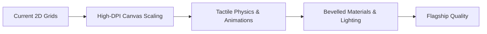

# Pixel Arcade: Master Platform Specification (v1.0)
**Online Play, Fair Play, Trophies, Storefront, and Visual Polish**

---

## 1. Executive Summary & Vision

**Pixel Arcade** is a retro-inspired, web-first gaming platform built on two core pillars:
1. **A Steam-style Digital Storefront & Hub:** A fast Vite-powered multi-page storefront (`index.html`, `store.html`) offering rich game previews, attract-mode simulations, specifications, controls guides, and career tracking, while keeping individual games as modular, standalone HTML applications.
2. **Instant, Authoritative Online Play & Trophies:** Casual multiplayer (unrated quick match and 6-character `/play/CODE` friend links) backed by server-authoritative Cloudflare Workers and Durable Objects, paired with a console-inspired declarative trophy and cosmetic reward layer.

### Key Principles
1. **Server Authority:** For all online matches, the server decides state, clocks, moves, and outcomes. The client is a rendering terminal and input provider.
2. **Casual & Fun First:** Launch is strictly casual. No public ratings, no competitive ladder stress, no pay-to-win, and no free-text toxicity.
3. **Honest Labeling:** Offline/solo achievements are explicitly marked **Local** (honour system). Only cryptographically signed online matches grant **Verified** trophies.
4. **Deterministic Cosmetic Rewards:** Trophies award XP and unlock cosmetics (themes, finishers, sound packs, frames). No random loot, no microtransactions.
5. **One Engine Contract:** Every game exposes an identical pure adapter contract (`/shared/games/<game>.js`) executing identically in the browser for instant client prediction and in Cloudflare Workers for authority.
6. **Zero Friction:** Anonymous identity generated silently on first online interaction. No passwords, no email verification, no tracking cookies.

---

## 2. Platform Architecture & Topology

```mermaid
flowchart TD
    subgraph Client ["Browser (Vercel Static / Vite MPA)"]
        Store["Store Front (index.html)"]
        GamePage["Store Game Page (store.html)"]
        Router["/play/CODE Router"]
        Games["Standalone HTML Games (/chess, /pool, etc.)"]
        Overlay["ArcadeShell Universal Overlay"]
        LocalAdapter["Local Adapter Prediction (/shared/games/)"]
        Store --> GamePage
        GamePage --> Games
        Router --> Games
        Games --- Overlay
        Games --- LocalAdapter
    end

    subgraph Edge ["Cloudflare Workers & Durable Objects"]
        WorkerFront["Worker Front Door (/api/identity, /play)"]
        Matchmaker["Matchmaker DO (Queues per game)"]
        MatchDO["Match DO (Authoritative State + Clocks)"]
        WorkerFront --> Matchmaker
        WorkerFront --> MatchDO
    end

    subgraph Data ["Cloudflare D1 & Storage"]
        D1DB[(Cloudflare D1)]
        MatchDO --> D1DB
        WorkerFront --> D1DB
    end

    LocalAdapter <-.->|WebSocket JSON (v1)| MatchDO
    Router <-.->|HTTPS| WorkerFront
```

### Component Distribution
* **Frontend Hosting (Vercel):** Static asset delivery. Vite MPA builds `index.html` (catalog) and `store.html` (game details), alongside `/dist` copies of standalone game directories (`/chess`, `/pool`, `/scrabble`, `/connect4`, `/ayo`, `/ludo`), PWA service worker (`sw.js`), and `/shared` libraries.
* **Worker Front Door (Cloudflare Workers):** Identity generation, Origin validation, room code lookup, and WebSocket routing to Durable Objects.
* **Match Object (Durable Object):** One instance per match. Owns state, clocks, and outcomes. Leverages WebSocket Hibernation so inactive or waiting rooms incur negligible costs.
* **Matchmaker Object (Durable Object):** Per-game queue pools pairing players using an unranked, private skill estimate.
* **Storage (Cloudflare D1):** Stores anonymous identity hashes, match logs with server timestamps, report queues, and verified trophy grants.

---

## 3. Identity & Local Storage Architecture

1. **Silent First-Touch Provisioning:**
   * On first online action (`Quick Match` or `Create Room`), the client issues `POST /api/identity`.
   * Server returns `{ id, secret, name }`. Server stores only `SHA-256(secret)`.
   * Client stores identity under its own dedicated key: `pixelarcade.identity`:
     ```json
     {
       "v": 1,
       "id": "ply_7f8a9b2c",
       "secret": "sec_9934fa...",
       "name": "Swift Falcon 42"
     }
     ```
   * **Isolation Rule:** Never written inside game-specific keys (e.g. `pixelchess.v1`).
2. **Name Generation:**
   * Launch uses deterministic Adjective + Noun + Number (e.g. `Pixel Knight 07`, `Neon Fox 91`).
   * Custom player names are deferred until an automated moderation/profanity filter is integrated.
3. **Privacy & Data Rights:**
   * No device fingerprinting or third-party tracking scripts.
   * Settings drawer provides **Reset Identity** (generates fresh keys) and **Delete My Data** (calls `DELETE /api/identity` to prune D1 logs, subject to open report retentions).

---

## 4. Universal Game Adapter Contract

Every title implements a pure, deterministic ES module placed in `shared/games/<game>.js`. It runs with zero modifications inside the browser (client-side prediction & offline play) and inside the Cloudflare Worker (authoritative simulation).

```javascript
// shared/games/<game>.js
export default {
  id: 'chess',                     // String identifier
  seats: 2,                        // 2 for Chess/Ayo/C4/Pool, 2-4 for Scrabble/Ludo
  modes: ['quick', 'room'],        // Supported online matchmaking modes
  
  // Initialize match state from configuration and an authoritative random seed
  init(config, seed) {},           // -> state

  // Apply a move from a specific seat. Pure function: no input mutation
  apply(state, seat, move, ctx) {},// -> { state, events: [...] } | { error: 'illegal_move' }

  // Masked state projection for a specific seat (hides opponent tiles, bag order)
  view(state, seat) {},            // -> sanitizedState

  // Clock status: which seat is running down time
  clock(state) {},                 // -> { turn: seat, graceMs } | null

  // Terminal state evaluation
  result(state) {}                 // -> null | { winner: seat | null, reason: 'mate'|'points'|'forfeit' }
};
```

### Strict Adapter Constraints
* **Pure & Deterministic:** No DOM APIs, no Node APIs, no `Date.now()`, no unseeded `Math.random()`.
* **Predictable Randomness:** Pseudo-randomness (dice, tile deals, board seeding) must exclusively derive from the PRNG seed passed in `ctx`.
* **Strict Serialization:** `state` and `view` must be valid, circular-reference-free JSON.

---

## 5. Wire Protocol (Version 1)

Communication between browser clients and the match Durable Object takes place over a single WebSocket connection using JSON text frames.

### Client-to-Server Messages
| Type (`t`) | Payload Schema | Description |
| :--- | :--- | :--- |
| `hello` | `{ v: 1, id, secret, resume? }` | Authenticate connection or resume a disconnected seat |
| `join` | `{ game, mode: 'quick'\|'room', room?, opts? }` | Enter matchmaking queue or join specific room code |
| `move` | `{ seq: number, move: any }` | Play move. `seq` is strictly monotonic per seat |
| `control` | `{ action: 'resign'\|'draw_offer'\|'draw_accept'\|'rematch' }` | Match control events |
| `emote` | `{ id: string }` | Fixed list only (e.g. `gg`, `nice_shot`, `thinking`, `salute`) |
| `report` | `{ matchId, reason }` | One-tap fair-play report |
| `ping` | `{}` | WebSocket keepalive |

### Server-to-Client Messages
| Type (`t`) | Payload Schema | Description |
| :--- | :--- | :--- |
| `welcome` | `{ playerId, serverTime }` | Authentication confirmed |
| `queued` | `{ estSeconds }` | Matchmaking waiting confirmation |
| `matched` | `{ matchId, seat, opponent: { name, frame, title }, config }` | Pairing found |
| `state` | `{ ver: number, view: any, clock: { seats: [...] } }` | Authoritative masked state |
| `events` | `[ { type, ...payload } ]` | Batch of events (triggers finishers & trophies) |
| `opp` | `{ status: 'connected'\|'disconnected', graceMs }` | Opponent connection status & reconnect timer |
| `over` | `{ result, reason, recordSignature }` | Terminal match summary with signed verification |
| `error` | `{ code: string, message?: string }` | Error notification |

### Error Codes
`bad_version`, `bad_message`, `unauthorised`, `illegal_move`, `not_your_turn`, `stale_seq`, `rate_limited`, `room_full`, `room_not_found`, `match_over`.

---

## 6. Matchmaking, Friend Rooms & Fair Play Safeguards

### Quick Match (Unrated)
* Queue matchmaker evaluates players within an elastic skill band.
* **10-Second Target:** If unmatched after 10 seconds, UI presents 3 fallbacks:
  1. *Share Friend Link* (spawns instant room code)
  2. *Practice vs CPU* (instant offline transition)
  3. *Keep Waiting* (widens match window further)

### Friend Rooms (`/play/CODE`)
* 6-character room codes generated from an unambiguous alphabet (`ABCDEFGHJKLMNPQRSTUVWXYZ23456789`).
* Handled by a lightweight edge router `/play/[code]` which looks up room metadata and transparently redirects to the correct game page with session tokens.
* Host configures basic room options (time controls, Pool aim assist toggle).

### Fair Play & Anti-Cheat Matrix
| Attack Vector | Architectural Mitigation |
| :--- | :--- |
| **State Tampering / Illegal Moves** | Server executes rules via `/shared/games/<game>.js`. Client moves are proposals. |
| **Information Leaks (Scrabble/Cards)** | `view(state, seat)` strips hidden racks and bag order before sending frames over the wire. |
| **Physics / Aim Hacks in Pool** | Shooter client sends only `(angle, power, spin)`. Server runs the authoritative 3D physics step, outputting identical keyframe trajectories to both clients. |
| **Clock Tampering** | Match DO manages clocks via DO Alarms. Local device time changes have zero effect. |
| **Connection Abandonment** | Grace timer (e.g. 60 seconds) starts on disconnect. Failure to reconnect yields a forfeit loss. Repeat leavers incur temporary queue cooldowns. |
| **Spam / Replay Flooding** | Monotonic sequence numbers (`seq`), token bucket rate limiters, strict Origin validation. |
| **External Bot Assistance (Chess/Scrabble)** | Casual launch mitigates financial incentives. Move timestamps and server logs are archived to D1 for forensic review upon user report. |

---

## 7. Declarative Trophy & Reward Engine

Trophies are defined as pure JSON data schemas executed identically by the browser trophy engine (offline/solo) and the Cloudflare Worker (verified online).

### Trophy Schema Specification
```json
{
  "id": "chess.backrank",
  "game": "chess",
  "name": "Back Door",
  "desc": "Deliver checkmate with a back-rank mate.",
  "tier": "bronze",
  "hidden": false,
  "scope": "local",
  "xp": 10,
  "on": "checkmate",
  "when": {
    "all": [
      { "field": "winner", "eq": "me" },
      { "field": "pattern", "eq": "back-rank" }
    ]
  },
  "modes": ["cpu", "2p", "online-quick", "online-room"]
}
```

```json
{
  "id": "pool.win50",
  "game": "pool",
  "name": "Table Master",
  "desc": "Win 50 online quick matches.",
  "tier": "silver",
  "hidden": false,
  "scope": "verified",
  "xp": 25,
  "on": "gameover",
  "when": { "field": "winner", "eq": "me" },
  "count": {
    "target": 50,
    "perDay": 10,
    "distinctOpponents": true
  },
  "modes": ["online-quick"]
}
```

### Predicate Operators
* Comparisons: `eq`, `ne`, `gt`, `gte`, `lt`, `lte`, `in`.
* Logic: `all`, `any`, `not`.

### Local vs. Verified Trophies
* **Local Trophies (Offline / CPU):** Stored in `pixelarcade.trophies` in browser LocalStorage. Visible on local profile. Honors system.
* **Verified Trophies (Online):** Evaluated server-side on match completion. Stored in D1 database and signed. Displayed on public opponent match cards with the **Verified Ribbon**.

### Anti-Farming Rules
1. Volume/streak trophies only progress in **Online Quick Match** against distinct opponent IDs.
2. Matches terminating via instant resignation (< 5 moves or < 30 seconds) or disconnects before threshold do not grant trophies.
3. Daily progression caps on volume milestones.

### Cosmetic Rewards & Finishers
* **Finishers:** Short, satisfying victory animations (e.g. shattering king pieces, 8-ball golden pocket vortex, burning line connects). Maximum 1.5s duration, skippable, disabled under `prefers-reduced-motion`.
* **Themes & Sound Packs:** Retro piece sets (Midnight, Glacier, Jade), customized board woods, and alternative Web Audio sound fonts.

---

## 8. Storefront & In-Game Shell Integration

### Storefront Elevators (`store.html`)
* **Attract Mode (Interactive Canvas Previews):** Standalone mini-simulations rendering directly inside the store page preview viewport when browsing titles.
* **Steam-Style Specifications & Features:** Player count, WebGL/Canvas tech, offline status, local career stats, and controls guides.
* **Store-Only Game Launching:** Catalog cards in `index.html` link directly to store preview pages. Direct play buttons removed from the lobby to establish a true digital storefront experience.

### Universal In-Game Overlay (`ArcadeShell`)
* Upgraded retro drawer overlay accessible across all games (`Shift+Tab` or Menu icon):
  * Trophy drawer & current progress.
  * Controls & rules cheatsheet.
  * Fair-play report dialog (attaches match replay snapshot).
  * Audio & CRT toggle settings.
  * Return to Store button.
* **Global CRT / HD Filter:** User preference stored in `pixelarcade.settings`:
  * *Modern HD (Default):* Smooth bilinear filtering, anti-aliased geometry.
  * *Retro CRT:* Scanlines, subtle phosphor glow, barrel curvature.

---

## 9. Visual & Presentation Elevation Standards

With **Pixel Chess** and **Pixel Pool** established as high-presentation benchmarks (anti-aliased geometry, linear filtering, DPR-aware high-resolution rendering), the remaining catalog games will be brought to parity:



### Target Upgrades by Title
1. **Ayo:**
   * Handcrafted carved wood-grain board with bevelled cavity shading.
   * Smooth bilinear marble seeds with specular reflections.
   * Fluid sowing animation: seeds lift, arc, and clack sequentially into pits.
2. **Connect 4:**
   * High-contrast bevelled plastic disc tokens.
   * Physics-based gravity acceleration with realistic bottom bounce and sound.
   * Pulsing animated win line overlay.
3. **Ludo:**
   * Antialiased track vectors and clean quadrant color coding.
   * 3D isometric dice roll with easing rotation and shadow cast.
   * Animated token hop transitions between squares.
4. **Scrabble:**
   * 3D tactile wooden tiles with embossed letters and point subscripts.
   * Subtle tile lift on drag/tap, smooth placement snapping.
   * Premium square star badges and polished score ribbon.

---

## 10. Phased Roadmap & Milestones

### Phase 1: Client-Side Foundations (No Server Required)
* **T0 — Trophy Core & Storefront Integration:**
  * Schema validator & predicate evaluator in `/shared/trophies.js`.
  * Local storage engine (`pixelarcade.trophies`) with `Shared.addXP` integration.
  * Animated pixel cup unlock toast & dedicated Trophy Room view.
* **T1 — Event Instrumentation (Chess, Pool, Scrabble, Ayo, C4, Ludo):**
  * Instrument local engines to emit standardized match events.
  * Implement starter trophy sets (~15 trophies per title).
* **T2 — Cosmetic & Finisher Framework:**
  * Finisher animator (1.5s max, skippable, reduced-motion compliant).
  * Unlockable board/piece cosmetics catalog.
* **P0 — Game Presentation Elevation:**
  * Visual upgrades for Ayo, Connect 4, Scrabble, and Ludo to match Chess/Pool standards.

### Phase 2: Online Infrastructure (Cloudflare Workers + Durable Objects)
* **M0 — Edge Gateway & Conformance Framework:**
  * Wrangler project, WebSocket hibernation scaffolding, identity endpoint (`POST /api/identity`).
  * Headless two-client integration test harness.
* **M1 — Online Chess (Reference Flagship):**
  * Core engine extracted to `/shared/games/chess.js`.
  * Quick match queue, friend rooms, server clock alarms, disconnect/reconnect grace handling.
  * Move and timing log recording to D1.
* **M2 — Global Play Online Flow & Edge Router:**
  * Universal `PLAY ONLINE` modal in all game UIs.
  * Lightweight `/play/[code]` room router.
* **M3 — Online Scrabble (Hidden Information Reference):**
  * Authoritative server bag and masked seat racks.
  * Verified word list verification on server.
* **M4 — Adapters for Connect 4, Ayo, Ludo, Draughts, Shogi:**
  * Conformance-tested pure adapters for remaining titles.
* **M5 — Online Pool (Server Physics Simulation):**
  * Server-side shot physics execution; identical trajectory distribution.

### Phase 3: Verified Layer & Polish
* **T3 — Verified Trophies & Server Cosmetics:**
  * Server awards verified trophies on game-over; public profiles display signed badges.
* **T4 — Community Rarity & Metrics:**
  * Global rarity percentages calculated across D1 trophy distributions.

---

## 11. Conformance & Verification Matrix

| Test Suite | Scope | Execution Target |
| :--- | :--- | :--- |
| **Adapter Conformance** | Tests every `/shared/games/<game>.js` for determinism, immutability, state masking, and rules conformance. | Node.js unit runner (`npm test`) |
| **Trophy Predicate Engine** | Golden-replay testing ensuring exact unlocks without false positives. | Node.js unit runner (`npm test`) |
| **Store & Hub Layout** | Validates 8-card grid, store preview navigation, keyboard shortcuts, and responsive breakpoints. | Playwright (`tests/hub-test.js`) |
| **Dual-Client Protocol Chaos** | Two headless browsers simulating packet loss, reconnect tokens, stale sequence numbers, and clock sync. | Cloudflare Wrangler local test suite |
| **Fair-Play Leak Verifier** | Inspects client WebSocket frames to assert hidden data (opponent racks, bag order) is never leaked. | Headless network interception test |

---

## 12. Future Proofing (Prizes & Competitions)

While real-money tournaments and cash prizes are strictly out of scope at launch, this architecture guarantees forward compatibility:
1. **Auditable Records:** D1 match records store signed, server-timed move transcripts.
2. **Account Portability:** Player identities can later link an optional verified competitor credential without altering the underlying gameplay DO architecture.
3. **Event Containers:** Matches can be instantiated with an `eventId` parameter, enforcing special tournament timers or bracket rules without modifying game logic.

---

## 13. Open Decisions

1. **Slow/Async Matches:** Should turn-based games (Chess, Scrabble, Ayo) support correspondence play (24h/move) via web push notifications, or maintain real-time clocks only?
2. **Log Retention Window:** Standardize log retention (recommended: 14 days for unflagged casual games, permanent for reported games).
3. **Default Time Controls:**
   * *Chess:* 5m+3s Blitz vs 10m Rapid.
   * *Pool:* 30s per shot.
   * *Ayo / Connect 4:* 30s turn timer.
   * *Scrabble:* 15m bank per player.
4. **Dictionary Licensing:** Confirm open-source dictionary dataset (e.g. ENABLE or NASPA wordlist) for the Scrabble adapter.
5. **Draughts & Shogi Deployment:** Sequence completion of remaining catalog titles with their online adapter launches.
